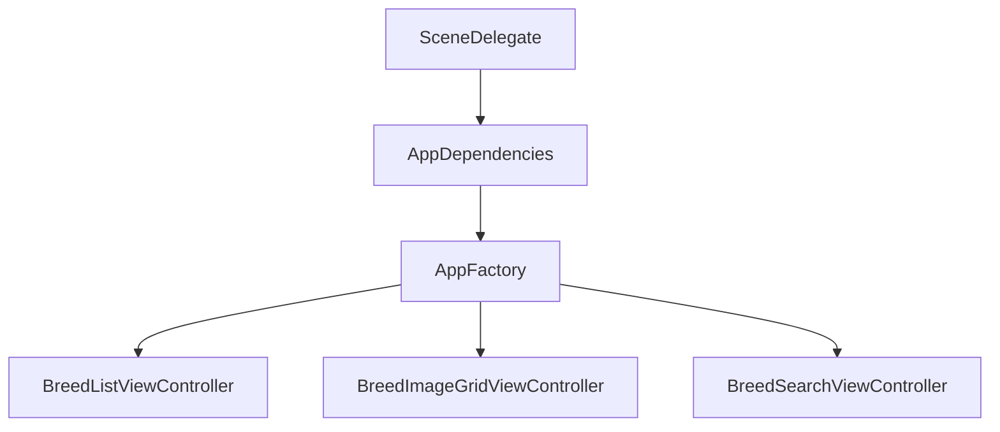
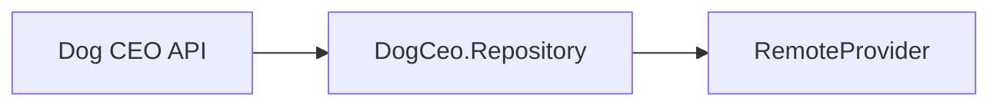
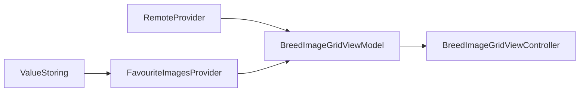
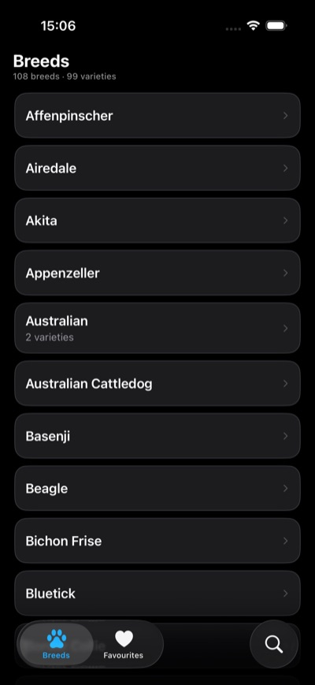
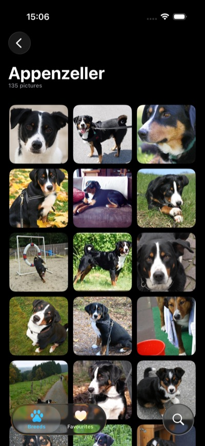
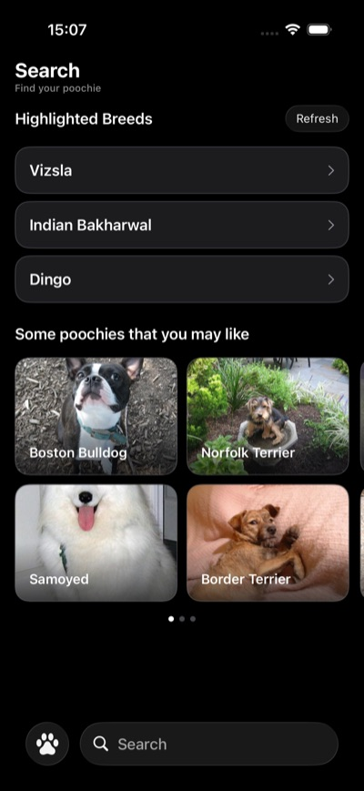
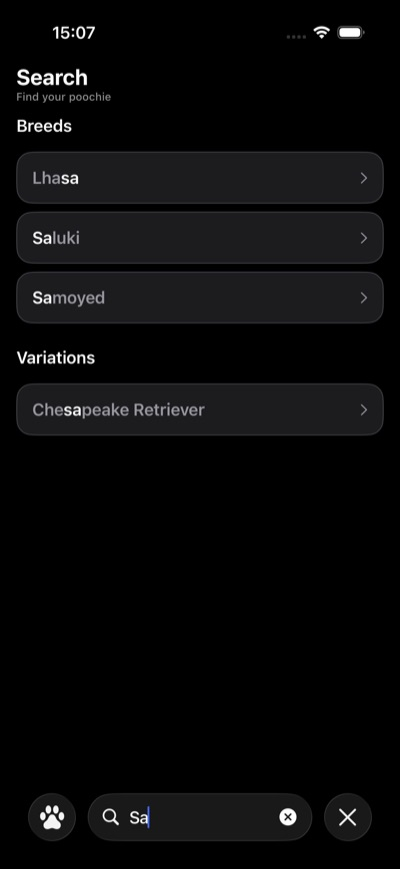

# DogCeo iOS Client App

Practice App to browse pictures of dogs using [Dog API](https://dog.ceo/dog-api/).
 Uses UIKit, SwiftUI, Swift 6 language mode, complete strict concurrency and MainActor default isolation.

## Requirements

The project runs with Xcode 27 and iOS 26.5.

## Features

The app allows you to do the following:

- Browse from a list of Breeds.
- Navigate through pictures of any selected Breed.
- See a Preview of any picture and add it to Favourites.
- Search any specific Breed or Variety.
- Persisted search history.

## Architecture

As this project is a practice project, it is split between pure UIKit screens (Breed List and Image Grids) and a hybrid SwiftUI screen (Search).
Each Screen is grouped in its own folder and follows MVVM pattern.

Dependencies are injected through a Factory, which is initialized in `SceneDelegate` and used to create the Window Root.

Most screens share the same loading behaviour, so the `LoadingProvider` protocol defines a state that views can observe: `loading`, `loaded` or `failed`. `RemoteProvider` implements it for every view model that fetches from the API. It takes the request as a closure so it's easier to stub in tests.

The requests themselves live in `DogCeo.Repository`, and `RemoteProvider` wraps them for each view model:

### Reusing the Image Grid for Favourites

The Favourites tab has no screen of its own. It uses the same `BreedImageGridViewController` as the breed images but configured with a different source and copy.

The source (`FavouriteImagesProvider`) conforms to `LoadingProvider` like `RemoteProvider` does, but reads from UserDefaults through a `ValueStoring` store instead of an API.
The copy to the view is injected through `BreedImageGridViewModel.Configuration`.

### Persistence

Favourites and Search History are saved in `UserDefaults` since a database would be overkill for the scope of the project. The trade-off is that every change rewrites its whole list.

Since both features behave the same way, they share a generic store, `UserDefaultValueStore<Value>`. They also depend on the protocol `ValueStoring`, so tests can use an isolated store.

### Navigation

Screens receive a `navigateTo` closure and call it with a `Destination` parameter. After this, `AppFactory` handles building the next screen and decides to present or push the target screen.

On the Search screen, the SwiftUI views receive the navigation closure through the environment.

### Downsampling

Since the API doesn't have a specific resolution for images, downsampling was used through `ImageCacheManager` to avoid reading heavy images. Downsampling is used both in SwiftUI and UIKit screens.

## Testing

Unit tests use Swift Testing and cover:

- `RemoteProvider` and `FavouriteImagesProvider`
- `UserDefaultValueStore`
- `ImageCacheManager`
- Search ViewModels

All data is stubbed, so tests don't perform network requests. They can be run with command+U.

## Screenshots

| Breed List | Breed Image Grid | Search | Results |
| --- | --- | --- | --- |
|  |  |  |  |

